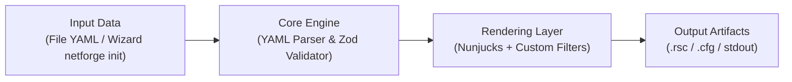

<div align="center">

```text
 _   _      _   _____                    
| \ | | ___| |_|  ___|__  _ __ __ _  ___ 
|  \| |/ _ \ __| |_ / _ \| '__/ _` |/ _ \
| |\  |  __/ |_|  _| (_) | | | (_| |  __/
|_| \_|\___|\__|_|  \___/|_|  \__, |\___|
                              |___/      
```

# ⚡ NetForge

**Declarative Multi-Vendor Network Device Config Generator CLI**

[](https://github.com/raihanalhamidy/NetForge/actions/workflows/ci.yml)
[](LICENSE)
[](https://nodejs.org/)
[](https://www.typescriptlang.org/)
[](tests/)
[](CONTRIBUTING.md)

[Quickstart](#quickstart-3-langkah) •
[Arsitektur](#arsitektur-sistem) •
[Demo Terminal](#showcase--terminal-preview) •
[Dukungan Vendor](#dukungan-vendor--perbandingan-fitur) •
[Kontribusi](#panduan-kontribusi)

</div>

---

## Mengapa NetForge?

**Masalah**: Mengonfigurasi banyak switch dan router dari berbagai vendor secara manual lewat CLI sangat rentan terhadap *human error*—mulai dari salah ketik VLAN ID, lupa memasukkan port ke trunk, hingga kesalahan konversi subnet mask antar perangkat.

**Solusi**: **NetForge** memisahkan *data topologi jaringan* (**YAML**) dari *sintaks CLI vendor* (**Nunjucks / Jinja2-compatible templates**). Setiap input divalidasi secara ketat saat runtime dengan **Zod** sebelum di-render menjadi script konfigurasi perangkat yang bersih dan siap pakai.

---

## Arsitektur Sistem



1. **Input Layer**: Pengguna membuat file YAML secara manual atau melalui wizard interaktif `netforge init`.
2. **Core Engine (`src/core/parser.ts`, `src/core/validator.ts`)**: Mem-parse YAML dan memvalidasi tipe, rentang VLAN (`1–4094`), format IPv4/CIDR, serta enum vendor menggunakan Zod.
3. **Rendering Layer (`src/core/renderer.ts`)**: Merender template `.njk` dengan `autoescape: false`, `trimBlocks: true`, `lstripBlocks: true`, serta filter bantu (`ip_only`, `subnet_mask`).
4. **Output Artifacts**: Menghasilkan script konfigurasi siap pakai ke terminal (`stdout`) atau file (`.rsc`, `.cfg`).

---

## Showcase & Terminal Preview

### 1. Interactive Setup Wizard (`netforge init`)

Buat file YAML konfigurasi jaringan secara interaktif tanpa menulis struktur YAML dari nol:

```text
$ node dist/index.js init

┌   ⚡ NetForge Interactive Setup Wizard
│
◆  Masukkan hostname perangkat:
│  RB-DIST-01
│
◆  Pilih vendor perangkat jaringan:
│  ● MikroTik RouterOS (Router / Switch RouterOS (.rsc))
│  ○ Cisco IOS
│  ○ Generic
│
◆  Masukkan Management IP (format IPv4/CIDR):
│  192.168.88.2/24
│
◆  Masukkan Gateway IP (opsional, tekan Enter untuk melewati):
│  192.168.88.1
│
◆  Masukkan VLAN ID #1 (1-4094):
│  10
│
◆  Masukkan nama untuk VLAN 10:
│  Management
│
◆  Tambah VLAN lagi?
│  ○ Yes / ● No
│
◆  Masukkan daftar Trunk Port (pisahkan dengan koma):
│  ether1, ether2
│
└  ✔ Konfigurasi berhasil disimpan ke: ./netforge-config.yaml
   Sekarang jalankan:
     netforge build -t templates/mikrotik/vlan_trunk.njk -d ./netforge-config.yaml
```

### 2. Generate Konfigurasi (`netforge build`)

```text
$ node dist/index.js build -t templates/cisco/vlan_access.njk -d data/samples/cisco_vlan.yaml -o output/cisco-switch.cfg

⏳ Memproses data konfigurasi dari: data/samples/cisco_vlan.yaml
⚙  Me-render template templates/cisco/vlan_access.njk untuk SW-ACCESS-01 (cisco)...
✔ Konfigurasi berhasil disimpan ke: output/cisco-switch.cfg
```

<details>
<summary>Lihat contoh file YAML input dan hasil output CLI MikroTik &amp; Cisco</summary>

#### Contoh Input YAML (`data/samples/mikrotik_vlan.yaml`)

```yaml
device:
  hostname: "RB-DIST-01"
  vendor: "mikrotik"
  mgmt_ip: "192.168.88.2/24"
  gateway: "192.168.88.1"

vlans:
  - id: 10
    name: "Management"
    description: "Management Network"
  - id: 20
    name: "Hotspot"
    description: "Hotspot Client Network"
  - id: 30
    name: "Office"
    description: "Internal Office Network"

interfaces:
  trunk:
    - "ether1"
    - "ether2"
  access:
    - name: "ether3"
      vlan_id: 20
    - name: "ether4"
      vlan_id: 30
```

#### Contoh Output MikroTik RouterOS (`.rsc`)

```rsc
# Generated by NetForge for RB-DIST-01 (MikroTik RouterOS)

/system identity set name="RB-DIST-01"

/interface bridge add name=bridge1 vlan-filtering=yes

# Bridge Ports - Trunk
/interface bridge port add bridge=bridge1 interface=ether1
/interface bridge port add bridge=bridge1 interface=ether2

# Bridge Ports - Access
/interface bridge port add bridge=bridge1 interface=ether3 pvid=20
/interface bridge port add bridge=bridge1 interface=ether4 pvid=30

# VLAN Interfaces
/interface vlan add interface=bridge1 name=Management vlan-id=10 comment="Management Network"
/interface vlan add interface=bridge1 name=Hotspot vlan-id=20 comment="Hotspot Client Network"
/interface vlan add interface=bridge1 name=Office vlan-id=30 comment="Internal Office Network"

# Bridge VLAN Filtering Table
/interface bridge vlan add bridge=bridge1 tagged=ether1,ether2 vlan-ids=10
/interface bridge vlan add bridge=bridge1 tagged=ether1,ether2 untagged=ether3 vlan-ids=20
/interface bridge vlan add bridge=bridge1 tagged=ether1,ether2 untagged=ether4 vlan-ids=30

# Management IP & Routing
/ip address add address=192.168.88.2/24 interface=bridge1
/ip route add dst-address=0.0.0.0/0 gateway=192.168.88.1
```

#### Contoh Output Cisco IOS (`.cfg`)

```text
! Generated by NetForge for SW-ACCESS-01 (Cisco IOS)
!
hostname SW-ACCESS-01
!
vlan 100
 name Voice
!
vlan 200
 name Data
!
interface Vlan1
 description Management Interface
 ip address 10.10.10.2 255.255.255.0
 no shutdown
!
ip default-gateway 10.10.10.1
!
interface GigabitEthernet0/1
 description Trunk Port
 switchport trunk encapsulation dot1q
 switchport mode trunk
 switchport trunk allowed vlan 100,200
 no shutdown
!
interface GigabitEthernet0/2
 switchport mode access
 switchport access vlan 200
 spanning-tree portfast
 no shutdown
!
end
```

</details>

---

## Dukungan Vendor & Perbandingan Fitur

| Vendor / OS | Status | Template | Fitur Konfigurasi |
| --- | --- | --- | --- |
| **MikroTik RouterOS v7** | ✅ Didukung | [`templates/mikrotik/vlan_trunk.njk`](templates/mikrotik/vlan_trunk.njk) | Identity, Bridge VLAN Filtering, Tagged/Untagged Ports, VLAN Interfaces, Management IP & Default Route |
| **Cisco IOS** | ✅ Didukung | [`templates/cisco/vlan_access.njk`](templates/cisco/vlan_access.njk) | Hostname, VLAN Database, Management SVI (`ip_only` & `subnet_mask`), Dot1Q Trunk, Access Portfast |
| **OpenWrt** | 🚧 Planned *(PR Welcome)* | `templates/openwrt/` *(via `vendor: generic`)* | UCI Network Config & DSA Bridge VLAN |
| **VyOS** | 🚧 Planned *(PR Welcome)* | `templates/vyos/` *(via `vendor: generic`)* | `set interfaces` & VLAN VIF |

> **Catatan**: Kontributor dapat langsung menambahkan template `.njk` untuk OpenWrt, VyOS, atau vendor lain menggunakan `vendor: "generic"` tanpa mengubah kode TypeScript inti.

---

## Quickstart 3-Langkah

Pastikan **Node.js >= 20** dan **npm** telah terpasang.

```bash
# 1. Clone & install dependencies
git clone https://github.com/raihanalhamidy/NetForge.git && cd NetForge && npm install

# 2. Build CLI bundle
npm run build

# 3. Generate konfigurasi dalam satu baris perintah
node dist/index.js build -t templates/cisco/vlan_access.njk -d data/samples/cisco_vlan.yaml -o output/cisco-switch.cfg
```

Ingin membuat data YAML sendiri terlebih dahulu? Jalankan wizard interaktif:

```bash
node dist/index.js init -o data/my-device.yaml
```

<details>
<summary>Daftar perintah npm &amp; opsi CLI lengkap</summary>

### Perintah CLI

| Command | Opsi | Keterangan |
| --- | --- | --- |
| `netforge init` | `-o, --output <path>` | Wizard interaktif pembuatan file YAML (default: `./netforge-config.yaml`) |
| `netforge build` | `-t, --template <path>` *(wajib)* | Path ke file template Nunjucks (`.njk`) |
| `netforge build` | `-d, --data <path>` *(wajib)* | Path ke file data input YAML |
| `netforge build` | `-o, --output <path>` *(opsional)* | Simpan hasil ke file; jika kosong, dicetak ke `stdout` |

### Scripts Pengembangan

```bash
npm run dev -- build -t templates/mikrotik/vlan_trunk.njk -d data/samples/mikrotik_vlan.yaml
npm run lint   # Cek tipe TypeScript (tsc --noEmit)
npm test       # Jalankan unit test Vitest (20 test cases)
npm run build  # Build ESM & deklarasi tipe (tsup)
```

</details>

---

## Struktur Proyek

```text
NetForge/
├── .github/
│   ├── ISSUE_TEMPLATE/
│   │   ├── bug_report.yml               # Form pelaporan bug
│   │   └── new_template_request.yml     # Form pengajuan template vendor baru
│   ├── workflows/
│   │   └── ci.yml                       # GitHub Actions (lint, test, build)
│   └── PULL_REQUEST_TEMPLATE.md         # Checklist kontributor PR
├── data/
│   └── samples/                         # Contoh input YAML (MikroTik & Cisco)
├── src/
│   ├── commands/                        # Handler subcommand CLI (init, build)
│   ├── core/                            # Validator Zod, Parser YAML, Renderer Nunjucks
│   ├── types/                           # Definisi tipe TypeScript
│   └── index.ts                         # Entry point CLI Commander
├── templates/                           # 📍 Lokasi template vendor (.njk)
│   ├── mikrotik/
│   │   └── vlan_trunk.njk
│   └── cisco/
│       └── vlan_access.njk
├── tests/                               # Unit test Vitest (validator, parser, renderer)
├── CONTRIBUTING.md
└── LICENSE
```

---

## Panduan Kontribusi

Kontribusi sangat terbuka—terutama penambahan template perangkat jaringan baru di folder [`templates/`](templates/) tanpa perlu mengubah *core* engine TypeScript.

- Baca panduan lengkap penamaan file, variabel Nunjucks, dan pengujian lokal di [CONTRIBUTING.md](CONTRIBUTING.md).
- Menemukan bug? Buat laporan lewat [Bug Report Template](.github/ISSUE_TEMPLATE/bug_report.yml).
- Ingin mengusulkan dukungan vendor baru? Gunakan [New Vendor Template Request](.github/ISSUE_TEMPLATE/new_template_request.yml).
- Siap mengirim kode atau template? Pastikan `npm run lint`, `npm test`, dan `npm run build` lulus lalu ikuti [Pull Request Template](.github/PULL_REQUEST_TEMPLATE.md).

---

## Lisensi

Dirilis di bawah lisensi [MIT](LICENSE) — Copyright © 2026 Raihan AlHamidy.
